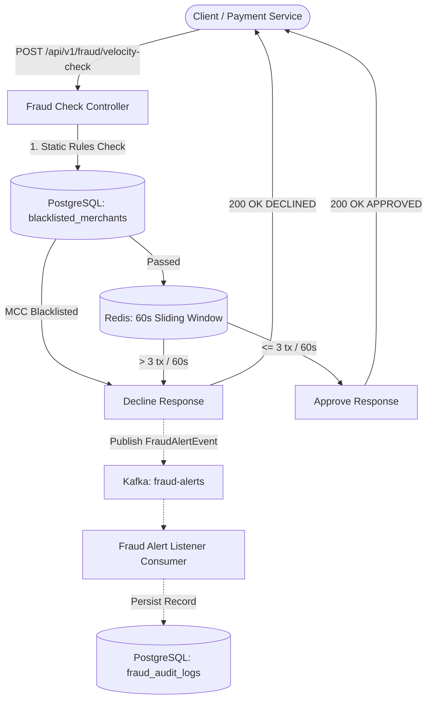

# ZBank Distributed Real-Time Fraud Detection & Velocity Engine

A real-time transaction processing and fraud detection service designed to evaluate payment requests against static merchant rules and sliding-window velocity limits. Built with Java 21 and Spring Boot 3.2.5, the system uses Java Virtual Threads for concurrent request handling, Redis pipelining for sliding-window velocity tracking, and Apache Kafka for asynchronous alert publishing and audit persistence.

## Architecture

The engine validates incoming payment transactions through a multi-stage pipeline:

1. **Static Rule Validation (PostgreSQL):** Checks the transaction against relational constraints, such as blacklisted Merchant Category Codes (MCCs).
2. **Velocity Evaluation (Redis):** Evaluates transaction frequency per card over a rolling 60-second sliding window.
3. **Synchronous Response:** Approves the transaction if limits and rules pass, or returns an immediate decline if a violation is detected.
4. **Asynchronous Audit Logging (Kafka):** When a transaction is declined, the engine publishes a `FraudAlertEvent` to a Kafka topic. An asynchronous consumer receives the event and writes the audit record to `fraud_audit_logs` in PostgreSQL without blocking the HTTP response.



## Key Technical Features

- **Virtual Threads:** Configured with Java 21 virtual threads enabled (`spring.threads.virtual.enabled: true`), allowing lightweight thread-per-request execution without thread pool exhaustion under concurrent load.
- **Batched Redis Pipelining:** Batches multiple Redis sorted-set operations (`ZADD`, `ZREMRANGEBYSCORE`, `ZCARD`, `EXPIRE`) into a single network round trip to compute sliding-window metrics.
- **Event-Driven Auditing:** Uses Apache Kafka in KRaft mode to decouple fraud detection from downstream database write operations.
- **Domain Validation & Immutability:** Uses Java 21 `record` types for immutable transaction payloads and Jakarta Validation annotations (`@NotNull`, `@Positive`, `@NotBlank`) with centralized `@ControllerAdvice` error handling.
- **Key Expiration & Memory Management:** Enforces a 60-second Time-To-Live (TTL) on Redis velocity keys (`velocity:card:{cardId}`) to prevent orphaned keys and manage memory usage.

## Technology Stack

- **Runtime & Language:** Java 21
- **Framework:** Spring Boot 3.2.5 (Spring Web, Spring Data JPA, Spring Data Redis, Spring Kafka, Validation)
- **In-Memory Datastore:** Redis 7.2 (Alpine)
- **Relational Database:** PostgreSQL 16 (Alpine)
- **Event Broker:** Apache Kafka 3.7.0 (KRaft mode)
- **Containerization:** Docker & Docker Compose
- **Database Management:** pgAdmin 4

## Local Development & Deployment

Infrastructure services are containerized with Docker Compose.

### 1. Initialize Infrastructure

Ensure Docker is running. Default credentials for local demo use are provided in `docker-compose.yml` and `.env.example`. Optionally copy `.env.example` to `.env` to customize settings:

```bash
cp .env.example .env
```

Start PostgreSQL, Redis, Kafka, and pgAdmin:

```bash
docker-compose up -d
```

*Note: PostgreSQL is mapped to host port `5433` to prevent collisions with local database installations.*

### 2. Boot the Spring Application

Run the application main method in `FraudVelocityEngineApplication.java`:

```bash
mvn spring-boot:run
```

Spring Boot will connect to PostgreSQL, Redis, and Kafka, and Hibernate will initialize the `blacklisted_merchants` and `fraud_audit_logs` tables.

### 3. Database Management (pgAdmin)

A visual database dashboard is available in the Docker stack:

- **URL:** http://localhost:5050
- **Credentials (local demo only, never reuse):** `admin@zbank.com` / `admin`
- **PostgreSQL Connection Host:** `postgres-db` (Port: `5432`, Database: `zbank_fraud`, Username: `postgres`, Password: `admin` — *local demo only, never reuse*)

## API Documentation

### Evaluate Transaction Velocity

Evaluates a single transaction against static blacklist rules and the 60-second Redis sliding-window limit.

- **Endpoint:** `POST /api/v1/fraud/velocity-check`
- **Content-Type:** `application/json`

#### Request Payload

```json
{
  "transactionId": "tx_uuid_string",
  "cardId": "card_554433",
  "accountId": "acc_112233",
  "amount": 150.00,
  "currency": "EUR",
  "merchantCategoryCode": "5411"
}
```

#### Success Response (200 OK)

Returned when the transaction passes all static rules and does not exceed the velocity limit:

```json
{
  "transactionId": "tx_uuid_string",
  "isFraudulent": false,
  "statusReason": "APPROVED"
}
```

#### Decline Response (200 OK)

Returned when a transaction exceeds the velocity limit or matches a blacklisted merchant. A decline asynchronously publishes a `FraudAlertEvent` to Kafka:

```json
{
  "transactionId": "tx_uuid_string",
  "isFraudulent": true,
  "statusReason": "DECLINED_VELOCITY_LIMIT_EXCEEDED"
}
```

#### Validation Error Response (400 Bad Request)

Returned when incoming payload fields fail validation:

```json
{
  "status": 400,
  "message": "Validation Failed",
  "details": {
    "amount": "Transaction amount must be strictly positive"
  },
  "timestamp": "2026-06-05T12:00:00.000Z"
}
```

## Results

TODO: benchmark numbers (see benchmarks/)

## Tests

The project includes an integration test suite verifying the sliding-window velocity detection logic:

- `VelocityFraudDetectorTest` (`src/test/java/com/zbank/fraud/service/VelocityFraudDetectorTest.java`): Spring Boot integration test suite validating Redis sliding-window operations and limits while mocking relational database and Kafka dependencies:
  - `shouldApproveSingleValidTransaction`: Verifies that an isolated valid transaction is approved.
  - `shouldApproveExactlyThreeTransactionsWithinSixtySeconds`: Verifies boundary handling up to 3 transactions within 60 seconds.
  - `shouldDeclineFourthTransactionWithinSixtySeconds`: Verifies that a 4th transaction within the 60-second window is declined.
  - `shouldApproveFourthTransactionIfOldestTransactionFellOutsideWindow`: Verifies sliding-window pruning (`ZREMRANGEBYSCORE`) when older transactions fall outside the 60-second window.
  - `shouldTrackVelocityIndependentlyForDifferentCards`: Confirms that Redis velocity counters are isolated per card without cross-card contamination.

### Running Tests

Ensure Redis is running (e.g., via `docker-compose up -d redis-cache`), then run:

```bash
mvn test
```
