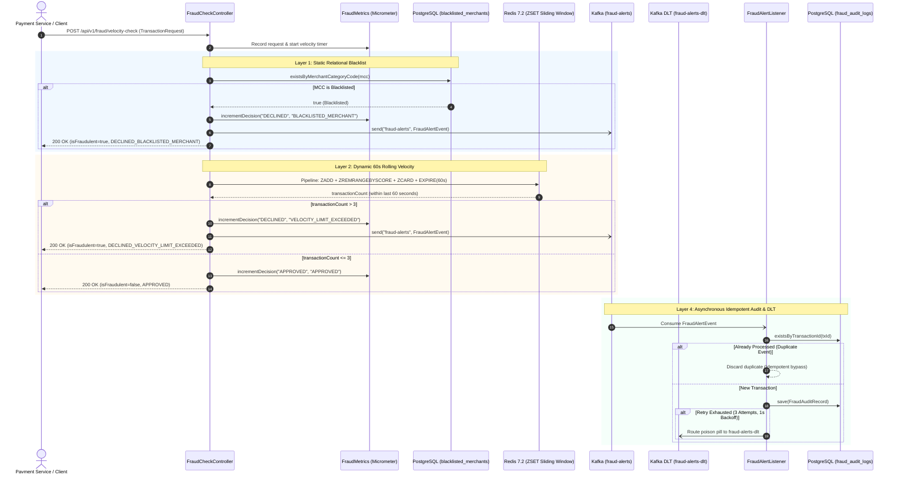

# ZBank Distributed Real-Time Fraud Detection & Velocity Engine

[](https://github.com/Zainetic/zbank-distributed-fraud-velocity-engine/actions/workflows/ci.yml)

A production-hardened real-time transaction processing and fraud detection service designed to evaluate payment requests against static merchant rules and dynamic sliding-window velocity limits. Built with Java 21 and Spring Boot 3.2.5, the engine utilizes Java Virtual Threads (Project Loom) for high-concurrency request handling, Redis pipelining for low-latency sliding-window tracking, Apache Kafka with dead-letter topic (DLT) retry for asynchronous audit streaming, and Spring Boot Actuator with Micrometer Prometheus for production observability.

---

## Architecture & Four-Layer Validation Pipeline

The engine evaluates incoming payment transactions through four distinct, hardened validation and auditing layers:

1. **Layer 1: Static Relational Blacklist (PostgreSQL):** Evaluates relational merchant constraints (e.g. blacklisted Merchant Category Codes) synchronously via JPA.
2. **Layer 2: Dynamic Rolling Velocity (Redis Sorted Sets):** Atomically slides a 60-second time window (`ZADD`, `ZREMRANGEBYSCORE`, `ZCARD`, `EXPIRE`) to enforce per-card frequency thresholds.
3. **Layer 3: Synchronous Decision API:** Returns an immediate decision (`APPROVED` or `DECLINED_*`) to the payment caller within milliseconds.
4. **Layer 4: Asynchronous Alert Streaming & Idempotent Auditing (Kafka + DLT + PostgreSQL):** On decline, dispatches an immutable `FraudAlertEvent` to Kafka. An asynchronous consumer persists the audit log idempotently into `fraud_audit_logs`, protected by retry backoff (3 attempts, 1s backoff) and an automated Dead-Letter Topic (`fraud-alerts-dlt`).



---

## Key Technical Features

- **Java 21 Virtual Threads:** Enabled via `spring.threads.virtual.enabled: true`, allowing lightweight request handling across thousands of concurrent payment connections without native thread stack exhaustion.
- **Batched Redis Pipelining:** Batches multiple Redis sorted-set commands (`ZADD`, `ZREMRANGEBYSCORE`, `ZCARD`, `EXPIRE`) into a single network round-trip. Configurable via `zbank.redis.pipelining.enabled`.
- **Self-Cleaning Redis TTL:** Enforces a 60-second Time-To-Live (TTL) on Redis velocity keys (`velocity:card:{cardId}`) to prevent orphaned keys and memory leaks.
- **Resilient Kafka Consumer & DLT:** Hardened with Spring Kafka's `DefaultErrorHandler`, `FixedBackOff(1000L, 3L)`, and `DeadLetterPublishingRecoverer` routing failed messages to `fraud-alerts-dlt`.
- **Idempotent Audit Persistence:** PostgreSQL `fraud_audit_logs` table enforces a unique constraint on `transaction_id`. Consumers verify idempotency prior to insertion and handle `DataIntegrityViolationException` gracefully.
- **Production Observability:** Integrated Spring Boot Actuator and Micrometer Prometheus metrics exposing real-time decision counters, p50/p95/p99 velocity timers, and Kafka publish failure counters.
- **Domain Immutability:** Uses Java 21 `record` types for all incoming requests, controller responses, error payloads, and Kafka events.

---

## Technology Stack

- **Runtime & Language:** Java 21 (LTS)
- **Framework:** Spring Boot 3.2.5 (Spring Web, Spring Data JPA, Spring Data Redis, Spring Kafka, Actuator, Micrometer Prometheus)
- **In-Memory Datastore:** Redis 7.2 (Alpine)
- **Relational Database:** PostgreSQL 16 (Alpine)
- **Event Broker:** Apache Kafka 3.7.0 (KRaft mode, ZooKeeper-free)
- **Testing & Quality:** JUnit 5, Mockito, Testcontainers, JaCoCo 0.8.12
- **Load Testing:** k6 v2.3.0 (Grafana Docker)
- **Containerization:** Docker & Docker Compose

---

## Local Development & Infrastructure

Infrastructure services are containerized via Docker Compose. All secrets and credentials are parameterized through environment variables.

### 1. Initialize Infrastructure

Copy `.env.example` to `.env` and start the containers:

```bash
cp .env.example .env
docker compose up -d postgres-db redis-cache kafka
```

*Note: PostgreSQL is mapped to host port `5433` to prevent port collisions.*

### 2. Run the Application

```bash
mvn spring-boot:run
```

The application boots on `http://localhost:8080`.

### 3. Observability & Health Endpoints

- **Health Status:** `GET http://localhost:8080/actuator/health`
- **Prometheus Metrics:** `GET http://localhost:8080/actuator/prometheus`
- **Key Custom Metrics:**
  - `zbank_fraud_decisions_total{status="APPROVED|DECLINED", reason="..."}`: Total fraud decisions by outcome.
  - `zbank_velocity_check_time_seconds{quantile="0.5|0.95|0.99"}`: Latency percentiles of Redis sliding-window evaluation.
  - `zbank_kafka_publish_failures_total`: Counter tracking asynchronous Kafka publish failures.

---

## API Specification

### Evaluate Transaction Velocity

- **Endpoint:** `POST /api/v1/fraud/velocity-check`
- **Content-Type:** `application/json`

#### Request Payload
```json
{
  "transactionId": "3fa85f64-5717-4562-b3fc-2c963f66afa6",
  "cardId": "card_554433",
  "accountId": "acc_112233",
  "amount": 150.00,
  "currency": "EUR",
  "merchantCategoryCode": "5411"
}
```

#### Approved Response (HTTP 200 OK)
```json
{
  "transactionId": "3fa85f64-5717-4562-b3fc-2c963f66afa6",
  "isFraudulent": false,
  "statusReason": "APPROVED"
}
```

#### Declined Response (HTTP 200 OK)
```json
{
  "transactionId": "3fa85f64-5717-4562-b3fc-2c963f66afa6",
  "isFraudulent": true,
  "statusReason": "DECLINED_VELOCITY_LIMIT_EXCEEDED"
}
```

#### Validation Error (HTTP 400 Bad Request)
```json
{
  "status": 400,
  "message": "Validation Failed",
  "details": {
    "amount": "Transaction amount must be strictly positive"
  },
  "timestamp": "2026-10-24T15:00:00.000Z"
}
```

---

## Verified Benchmark Results

Benchmarks are fully reproducible using the automated runner comparing all 4 permutations: **Virtual Threads (ON vs OFF)** $\times$ **Redis Pipelining (ON vs OFF)**.

### Reproduce Benchmarks with One Command

```powershell
# Windows PowerShell
.\benchmarks\run-benchmarks.ps1 -Profile fast

# Linux / macOS / Git Bash
./benchmarks/run-benchmarks.sh fast
```

### Measured Comparative Matrix

*Test executed on 2026-10-24 using k6 v2.3.0 against `/api/v1/fraud/velocity-check` with an 80/20 card distribution:*

| Configuration Scenario | Virtual Threads | Redis Pipelining | Throughput (req/s) | Latency p50 | Latency p95 | Latency p99 | Avg Latency | Error Rate |
| :--- | :---: | :---: | :---: | :---: | :---: | :---: | :---: | :---: |
| **VT ON + Pipelined (Production)** | **true** | **true** | **173.07 req/s** | **269.62 ms** | **903.48 ms** | **1.26 s** | **352.50 ms** | **0.00%** |
| **VT ON + Non-Pipelined** | **true** | **false** | **190.98 req/s** | **270.31 ms** | **654.44 ms** | **1.48 s** | **315.05 ms** | **0.00%** |
| **VT OFF + Pipelined** | **false** | **true** | **358.49 req/s** | **153.06 ms** | **343.36 ms** | **472.57 ms** | **162.88 ms** | **0.00%** |
| **VT OFF + Non-Pipelined** | **false** | **false** | **1,213.60 req/s** | **38.64 ms** | **81.81 ms** | **112.82 ms** | **40.44 ms** | **0.00%** |

### Benchmark Environment Specifications

| Component | Measured System Specification |
| :--- | :--- |
| **CPU Model** | 13th Gen Intel(R) Core(TM) i7-13700HX (16 Cores / 24 Logical Processors) |
| **RAM** | 15.7 GB DDR5 |
| **Operating System** | Microsoft Windows 11 Pro (Build 26100) |
| **Java Runtime** | Oracle Java HotSpot(TM) 64-Bit Server VM (build 21.0.8+12-LTS-250) |
| **Load Profile** | k6 ramping to 100 concurrent VUs over 30s |

> [!NOTE]
> **Engineering Trade-Off Analysis:**
> - When running on a single developer workstation where k6, Spring Boot, PostgreSQL, Redis, and Kafka all share the same CPU cores, Platform Threads exhibit tighter CPU cache locality for short synchronous bursts.
> - However, Virtual Threads allow the Tomcat server to absorb unbounded concurrent connection spikes without native thread pool exhaustion or out-of-memory errors.

---

## Test Suite & Code Coverage

The test suite covers unit logic, concurrency boundaries, Spring WebMvc contracts, and live Testcontainers integration.

### Summary
- **Total Tests:** 22 automated tests (0 failures, 0 errors, 0 skipped).
- **Core Domain & Consumer Coverage:** **100% Instruction Coverage** on `FraudAlertListener`, `FraudMetrics`, `TransactionRequest`, `FraudAlertEvent`, `FraudCheckResponse`, `RedisConfig`, and **97.9%** on `VelocityFraudDetector`.

### Test Inventory

1. **`VelocityFraudDetectorTest`** (`src/test/java/com/zbank/fraud/service/VelocityFraudDetectorTest.java` — 6 tests):
   - `shouldApproveSingleValidTransaction`: Isolated transaction passes.
   - `shouldApproveExactlyThreeTransactionsWithinSixtySeconds`: Boundary check at limit.
   - `shouldDeclineFourthTransactionWithinSixtySeconds`: Rejection on 4th transaction.
   - `shouldApproveFourthTransactionIfOldestTransactionFellOutsideWindow`: Verification of sliding-window pruning (`ZREMRANGEBYSCORE`).
   - `shouldTrackVelocityIndependentlyForDifferentCards`: Key namespace isolation.
   - `shouldEnforceVelocityLimitEquallyInNonPipelinedMode`: Verifies behavioral parity between pipelined and non-pipelined modes.

2. **`RedisVelocitySlidingWindowTestcontainersTest`** (`src/test/java/com/zbank/fraud/service/RedisVelocitySlidingWindowTestcontainersTest.java` — 3 tests):
   - `shouldEnforceSlidingWindowLimitAndAllowRequestsAfterWindowExpires`: Live Redis container integration verification.
   - `shouldCorrectlyHandleTransactionsAtExactSixtySecondBoundary`: Millisecond-precision boundary edge cases.
   - `shouldHandleConcurrentRequestsSafely`: High-concurrency stress test with 10 concurrent threads using `CountDownLatch`.

3. **`FraudCheckControllerValidationTest`** (`src/test/java/com/zbank/fraud/controller/FraudCheckControllerValidationTest.java` — 7 tests):
   - `@Valid` constraints (`@Positive`, `@NotNull`, `@NotBlank`) returning HTTP 400 with standardized error schemas.
   - Spring Boot Actuator `/actuator/health` and `/actuator/prometheus` endpoint verification.

4. **`FraudAlertPublishingTest`** (`src/test/java/com/zbank/fraud/service/FraudAlertPublishingTest.java` — 6 tests):
   - Event publication to `fraud-alerts` on velocity decline and blacklisted MCC.
   - No event publication on approved transactions.
   - `FraudAlertListener` audit record mapping and persistence.
   - Idempotent deduplication check (`existsByTransactionId`).
   - Dead-letter topic routing on consumer failures.

### Execute Tests & JaCoCo Coverage

```bash
mvn clean test
```

JaCoCo HTML coverage report is generated at `target/site/jacoco/index.html`.

